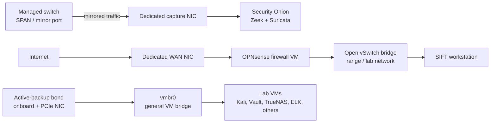

# Security Home Lab: Proxmox, Security Onion, and Automation

A single-node Proxmox VE lab I use to practice defensive operations, network monitoring, digital forensics, and infrastructure automation. It started as a place to test tooling and is growing into a repeatable attack-and-detect range.

> **Status:** Core platform, monitoring, and templating are running. n8n automation and attack validation are in progress. A 3-node cluster is planned, pending hardware (see [Roadmap](#roadmap)). I've kept the "built" and "planned" sections separate on purpose.

---

## Repository layout

| Folder | Contents |
|---|---|
| [`ansible/`](ansible/) | Playbooks for installing the Elastic Stack (Elasticsearch, Kibana) and deploying Elastic Agent, plus an example inventory |
| [`cloud-init/`](cloud-init/) | First-boot config and disk-grow script used by my VM templates |
| [`proxmox/`](proxmox/) | Script that creates the template VM shell |
| [`local-ai/`](local-ai/) | Docker Compose, Modelfile, and setup notes for Ollama + Open WebUI |
| [`detections/`](detections/) | Detection content from attack-and-detect cycles (planned, none published yet) |
| [`writeups/`](writeups/) | Write-up template and future write-ups |

---

## Goals

- Practice **network security monitoring** on real traffic (Zeek, Suricata, Security Onion)
- Build a **repeatable, automated VM provisioning** workflow (cloud-init, Ansible, templates)
- Run an **isolated range** for forensics and adversary-emulation practice
- Experiment with **on-prem AI** for security workflows without sending data to third parties

---

## Hardware

| Component | Detail |
|---|---|
| Hypervisor | Proxmox VE 9.1 (kernel 6.17) |
| CPU | Intel Core i5-4590 (4 cores) |
| Memory | 32 GB RAM |
| Storage | 2 TB HDD (LVM-thin) + 1 TB SATA SSD (LVM-thin and directory storage) |
| Networking | Onboard Intel NIC + quad-port Broadcom BCM5719 PCIe NIC |

---

## Architecture

### Network design

- **Traffic capture:** A switch mirror port feeds a dedicated NIC with MAC learning disabled, so Security Onion sees all traffic leaving the host. This does *not* capture VM-to-VM traffic on the same bridge. Closing that gap with an OVS mirror is on the roadmap.
- **Firewall isolation:** OPNsense runs as a VM with its own physical WAN NIC and sits in front of an Open vSwitch lab segment.
- **Redundancy:** The primary bridge uses an active-backup bond across an onboard and a PCIe NIC.
- **Isolated bridge:** A separate bridge with no physical uplink is used for coursework and exercises that must stay off the network.

---

## What's running

The host has about 23 VM definitions, including templates. The main roles:

| Role | Purpose |
|---|---|
| Security Onion | Network security monitoring (Zeek, Suricata) fed by the mirror port |
| OPNsense | Firewall / routing for the lab segment |
| Kali Linux | Offensive tooling |
| SIFT Workstation | Digital forensics and incident response analysis |
| Velociraptor (test) | Endpoint visibility and DFIR collection testing |
| Elastic stack (ELK / Fleet) | SIEM and endpoint-agent experiments, installed with [Ansible](ansible/) and snapshotted at each working stage |
| HashiCorp Vault | Secrets management experiments |
| TrueNAS | Storage and backup target experiments |
| Windows 11 | Target host for detection exercises |
| Linux playgrounds | RHEL 9/10, Ubuntu, Rocky for configuration management practice |
| n8n (MCP-enabled) | Running; playbook and workflow configuration in progress |

Local AI (Ollama and Open WebUI, running a tuned Qwen3 4B model) runs in Docker on a separate workstation with an NVIDIA GTX 1060 6GB (upgrade planned) for private, on-prem experimentation. Setup is documented in [`local-ai/`](local-ai/).

---

## Automation and provisioning

- **Templates:** Dated baseline templates for Debian, Ubuntu, and Rocky Linux, so every new VM starts from a known state. The template shell is created by [`proxmox/create-template.sh`](proxmox/create-template.sh).
- **cloud-init:** Used for hostnames, users, SSH keys, and first-boot configuration, including growing separate `/var` and `/home` disks after a clone is resized. See [`cloud-init/`](cloud-init/).
- **Ansible:** Used for post-provision configuration and package/service setup. Current playbooks install Elasticsearch and Kibana and enroll hosts with Elastic Agent. See [`ansible/`](ansible/).
- **Snapshots as checkpoints:** Named snapshots before risky changes (for example before enabling Elastic Fleet or adding a tunnel) so I can roll back and compare.

### Secrets handling

No keys, tokens, or passwords are stored in this repo. SSH keys stay in `~/.ssh`, playbooks prompt for passwords and enrollment tokens at run time, container secrets live in a gitignored `.env`, and real inventories are gitignored (only `*.example.*` files are published).

---

## Lessons learned

- **Flat networks hide attacks.** A mirror port only sees what leaves the host. Internal traffic needs its own visibility.
- **Snapshots are not backups.** They protect against a bad change, not disk failure. Real backups go to a separate target.
- **Memory is the real limit.** Security Onion needs a large share of RAM, which constrains what else can run at once. This is a main reason I'm planning a cluster.
- **Storage tiering matters.** Putting high-write workloads on the right disk made a noticeable difference in how stable ingest was.

---

## Roadmap

- [ ] **Attack-and-detect validation (in progress):** run MITRE ATT&CK techniques (Atomic Red Team / Caldera) against an instrumented range, check what Security Onion and the endpoint agents see, and write or tune rules for the gaps. Results and rules will be published in [`detections/`](detections/) and [`writeups/`](writeups/).
- [ ] **n8n automation (in progress):** alert enrichment and triage workflows.
- [ ] **VM-to-VM visibility:** mirror the lab bridge to a Security Onion sensor interface.
- [ ] **Hardening pass:** enable the Proxmox firewall at the datacenter level, separate management from guest traffic, move to named admin accounts with MFA, and add scheduled backups to TrueNAS.
- [ ] **Secrets in automation:** move Ansible from run-time prompts to Ansible Vault or SOPS + age so runs can be non-interactive.
- [ ] **3-node Proxmox cluster (planned, pending hardware):** hyper-converged design with shared storage and HA.
- [ ] **Honeypot deployment:** monitored with the lab's detection stack. (ISC internship write-ups coming soon)

---

## Skills demonstrated

Virtualization and hypervisor administration, network security monitoring, Zeek and Suricata, DFIR tooling, firewall and network design, Linux administration, infrastructure as code (Ansible, cloud-init), containerized services with NVIDIA GPU access, and local AI deployment.
